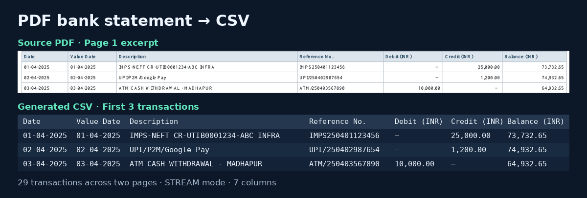
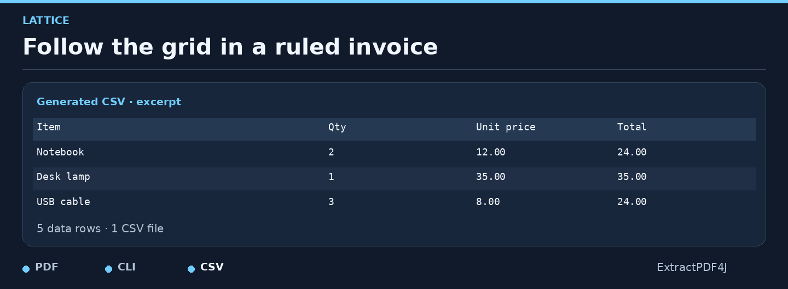
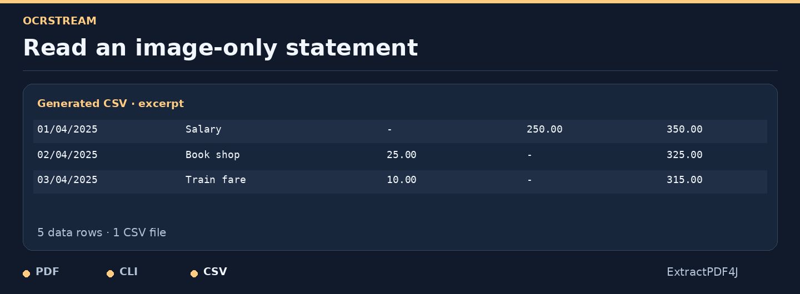
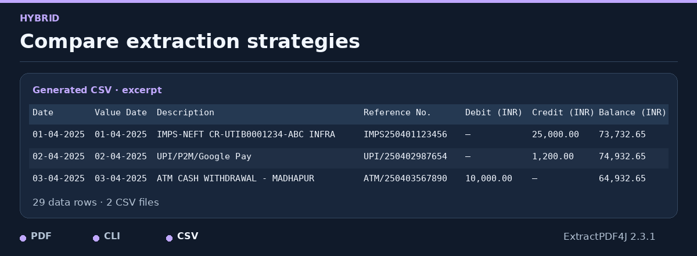

# ExtractPDF4J

Extract tables from selectable text, ruled grids, and scanned PDFs in Java. Export the results to CSV or JSON, or work with the rows directly in your application.

<div class="extract-home">
  <div class="extract-hero">
    <video controls playsinline preload="none" poster="images/extractpdf4j-banner-light.png" aria-label="ExtractPDF4J PDF-to-CSV walkthrough and Java tool comparison">
      <source src="images/extractpdf4j-banner-motion.mp4" type="video/mp4">
      <a href="images/extractpdf4j-banner-motion.mp4">Download the banner video</a>
    </video>
    <div class="extract-actions">
      <a class="md-button md-button--primary" href="#watch-the-four-parsing-demos">Watch the parsing demos</a>
      <a class="md-button" href="getting-started/">Get started</a>
      <a class="md-button" href="apidocs/index.html">Java API docs</a>
    </div>
  </div>
</div>

## Watch the four parsing demos

Each demo shows the source PDF, the CLI command, and rows from the generated CSV. [Get the sample PDFs, expected CSVs, and commands on GitHub](https://github.com/ExtractPDF4J/ExtractPDF4J/tree/main/examples/parsing-modes).

<div class="extract-home">
  <div class="extract-gallery">
    <article class="extract-demo">
      <a href="images/statement-to-csv-demo.gif"></a>
      <div class="extract-demo-body">
        <h3>STREAM</h3>
        <p>Group selectable text into columns. The two-page example exports 29 transactions.</p>
        <p class="extract-media-link"><a href="images/statement-to-csv-demo.gif">Open animation</a> · <a href="how-it-works/stream/">How STREAM works</a></p>
      </div>
    </article>
    <article class="extract-demo">
      <a href="images/lattice-parsing-demo.gif"></a>
      <div class="extract-demo-body">
        <h3>LATTICE</h3>
        <p>Follow visible grid lines to recover the cells of an invoice table.</p>
        <p class="extract-media-link"><a href="images/lattice-parsing-demo.gif">Open animation</a> · <a href="how-it-works/lattice/">How LATTICE works</a></p>
      </div>
    </article>
    <article class="extract-demo">
      <a href="images/ocrstream-parsing-demo.gif"></a>
      <div class="extract-demo-body">
        <h3>OCRSTREAM</h3>
        <p>Use Tesseract to recognize text and recover columns from an image-only PDF.</p>
        <p class="extract-media-link"><a href="images/ocrstream-parsing-demo.gif">Open animation</a> · <a href="how-it-works/ocr-stream/">How OCRSTREAM works</a></p>
      </div>
    </article>
    <article class="extract-demo">
      <a href="images/hybrid-parsing-demo.gif"></a>
      <div class="extract-demo-body">
        <h3>HYBRID</h3>
        <p>Compare extraction strategies when you are unsure how the PDF represents its table.</p>
        <p class="extract-media-link"><a href="images/hybrid-parsing-demo.gif">Open animation</a> · <a href="how-it-works/hybrid/">How HYBRID works</a></p>
      </div>
    </article>
  </div>
</div>

## Compare Java PDF tools

- **ExtractPDF4J** extracts structured tables from text-based and scanned PDFs using stream, lattice, OCR stream, and hybrid modes.
- **Tabula Java** extracts tables from text-based PDFs using stream and lattice modes. [Tabula Java CLI and API](https://github.com/tabulapdf/tabula-java)
- **Apache PDFBox** creates, edits, renders, and extracts text from PDFs. ExtractPDF4J uses it for PDF processing. [PDFBox features](https://pdfbox.apache.org/) · [Command-line tools](https://pdfbox.apache.org/3.0/commandline.html)
- **Aspose.PDF for Java** creates and edits PDFs and exposes table rows and cells through its `TableAbsorber` API. [Aspose.PDF for Java](https://docs.aspose.com/pdf/java/) · [Table extraction example](https://docs.aspose.com/pdf/java/extract-data-from-table-in-pdf/)

✓ means the named tool provides the feature directly. ✗ means the feature requires other tooling or custom code.

| Capability | ExtractPDF4J | Tabula Java | Apache PDFBox | Aspose.PDF for Java |
| --- | :---: | :---: | :---: | :---: |
| Table extraction API | ✓ | ✓ | ✗ | ✓ |
| OCR to tables in one workflow | ✓ | ✗ | ✗ | ✗ |
| CLI exports tables to both CSV and JSON | ✓ | ✓ | ✗ | ✗ |
| General-purpose PDF creation and editing | ✗ | ✗ | ✓ | ✓ |

For image-only pages, Tabula requires a text layer from an OCR tool. PDFBox can render pages for an external OCR engine, and Aspose provides PDF recognition through a separate Aspose.OCR product. [Tabula scan guidance](https://github.com/tabulapdf/tabula#using-tabula) · [PDFBox rendering](https://pdfbox.apache.org/3.0/commandline.html) · [Aspose.OCR for Java](https://docs.aspose.com/ocr/java/recognition/)

[Try the ExtractPDF4J parsing demos](#watch-the-four-parsing-demos) to see the sample inputs and generated outputs.

## Use the Java API

Start with `HybridParser` when the layout is mixed or unknown.

```java
import com.extractpdf4j.helpers.Table;
import com.extractpdf4j.parsers.HybridParser;

import java.util.List;

public class QuickStart {
    public static void main(String[] args) throws Exception {
        List<Table> tables = new HybridParser("sample.pdf")
                .pages("all")
                .dpi(300f)
                .parse();

        if (!tables.isEmpty()) {
            System.out.println(tables.get(0).toCSV(','));
        }
    }
}
```

See the [Java quickstart](quickstart.md), [installation guide](installation.md), or [CLI reference](cli.md) to run your first extraction.

## Contribute

If ExtractPDF4J helps you, [star the project](https://github.com/ExtractPDF4J/ExtractPDF4J) so more Java developers can find it. [Open an issue](https://github.com/ExtractPDF4J/ExtractPDF4J/issues/new/choose) to share a bug or an idea, or [fork the repository](https://github.com/ExtractPDF4J/ExtractPDF4J/fork) and follow the [contributing guide](contributing.md).
