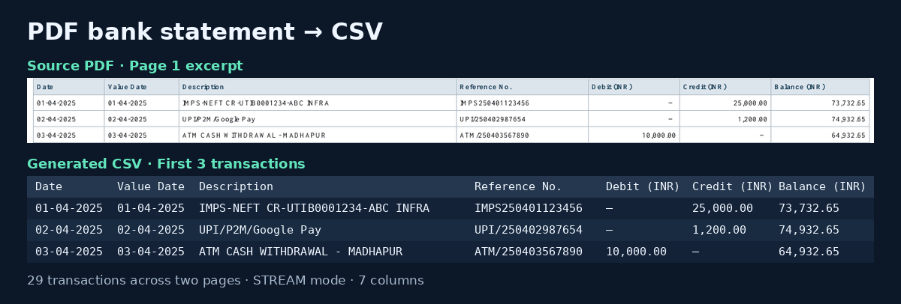
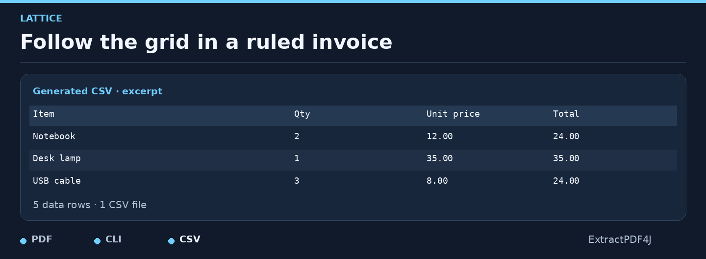
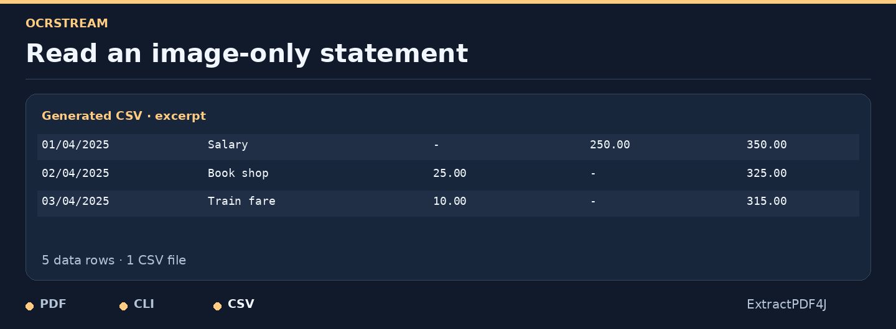
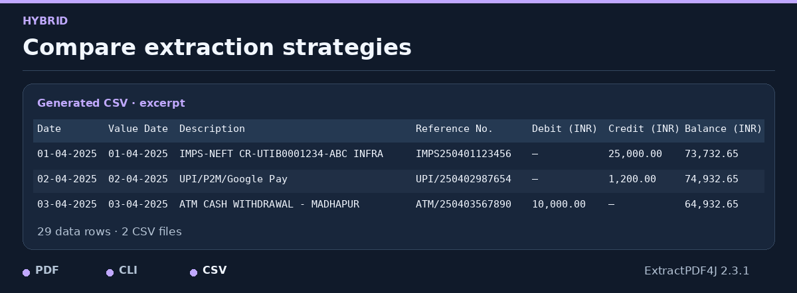

# ExtractPDF4J parsing demos

Each GIF shows a real example PDF, the command, and rows from its generated CSV. All files use synthetic data.

Build the CLI from the repository root with Java 17 and Maven. Install Tesseract with English language data for OCRSTREAM and HYBRID.

```bash
mvn -pl extractpdf4j-cli -am clean package -DskipTests
cp "$(find extractpdf4j-cli/target -maxdepth 1 -type f -name 'extractpdf4j-cli-*.jar' \
  ! -name '*-sources.jar' ! -name '*-javadoc.jar')" extractpdf4j-cli.jar
```

## STREAM

Use STREAM when the PDF has selectable text and the table columns are separated by spacing.



[Source PDF](../synthetic-bank-statement/synthetic_bank_statement_text.pdf) · [Expected page 1 CSV](../synthetic-bank-statement/bank_statement_hybrid-1.csv) · [Expected page 2 CSV](../synthetic-bank-statement/bank_statement_hybrid-2.csv)

```bash
java -jar extractpdf4j-cli.jar \
  examples/synthetic-bank-statement/synthetic_bank_statement_text.pdf \
  --mode STREAM --pages all --out bank_statement.csv
```

## LATTICE

Use LATTICE when visible horizontal and vertical lines form a grid around the cells.



[Source PDF](ruled-invoice.pdf) · [Expected CSV](ruled-invoice.csv)

```bash
java -jar extractpdf4j-cli.jar \
  examples/parsing-modes/ruled-invoice.pdf \
  --mode LATTICE --pages 1 --out lattice.csv
```

## OCRSTREAM

Use OCRSTREAM when the page is an image. Tesseract reads the text in this sample, and the CSV contains five data rows. The parser uses the recognized header to locate columns and omits it from the CSV.



[Source PDF](scanned-statement.pdf) · [Expected CSV](scanned-statement.csv)

```bash
java -jar extractpdf4j-cli.jar \
  examples/parsing-modes/scanned-statement.pdf \
  --mode OCRSTREAM --pages 1 --out ocrstream.csv
```

## HYBRID

Use HYBRID when you want ExtractPDF4J to compare extraction strategies. On this text-based sample, HYBRID and STREAM generate identical CSVs.



[Source PDF](../synthetic-bank-statement/synthetic_bank_statement_text.pdf) · [Expected page 1 CSV](../synthetic-bank-statement/bank_statement_hybrid-1.csv) · [Expected page 2 CSV](../synthetic-bank-statement/bank_statement_hybrid-2.csv)

```bash
java -jar extractpdf4j-cli.jar \
  examples/synthetic-bank-statement/synthetic_bank_statement_text.pdf \
  --mode HYBRID --pages all --out hybrid.csv
```
